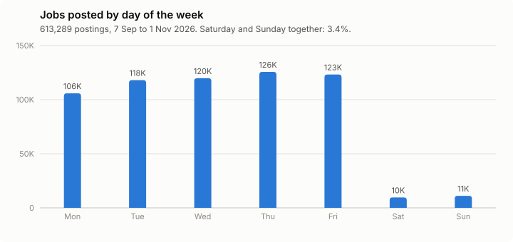
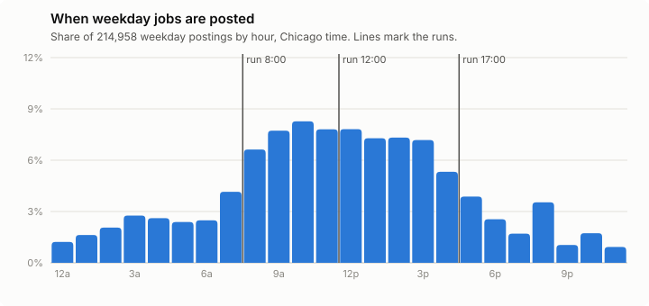
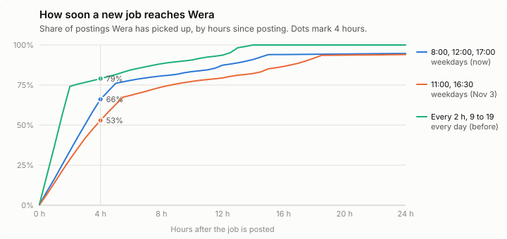

# When Wera looks for new jobs

Wera's worker reads every job board it watches, saves new postings, and scores them for each user. Since 4 November 2026 it does this three times on weekdays:

```
RUN_SCHEDULE=08:00,12:00,17:00
RUN_DAYS=Mon-Fri
RUN_TIMEZONE=America/Chicago
```

This page explains why, with the data behind it. The short version:

- Almost no jobs are posted on weekends (3.4%), so weekend runs find little.
- Jobs are posted during US business hours. A run at 8:00 picks up everything posted overnight before people start their day, a run at 12:00 catches the morning, and a run at 17:00 catches the afternoon.
- The schedule is mostly not about AI cost: that follows the number of new postings, not the number of runs. It is about freshness against the load each run puts on the job boards and on the server.

All numbers come from a copy of the production database taken on 3 November 2026, covering the eight weeks from Monday 7 September to Sunday 1 November 2026. The charts can be redrawn with [`scripts/run-schedule/charts.py`](../scripts/run-schedule/charts.py).

## Jobs are posted on weekdays

<picture>
  <source media="(prefers-color-scheme: dark)" srcset="run-schedule/posting-days-dark.svg">
  
</picture>

| Day | Postings | Share |
|---|---:|---:|
| Monday | 105,834 | 17.3% |
| Tuesday | 118,010 | 19.2% |
| Wednesday | 119,823 | 19.5% |
| Thursday | 125,643 | 20.5% |
| Friday | 123,227 | 20.1% |
| Saturday | 9,615 | 1.6% |
| Sunday | 11,137 | 1.8% |
| **Total** | **613,289** | |

The pattern holds for every job system Wera reads (Greenhouse, Lever, Ashby, Workday, SmartRecruiters, Oracle and the rest), so it is how employers work, not a quirk of one system. Monday is lowest partly because 7 September was Labor Day. The dates are the ones each job board gives for when the posting went up, not when Wera first saw it.

The few weekend postings are picked up by the Monday 8:00 run.

## Jobs are posted during business hours

<picture>
  <source media="(prefers-color-scheme: dark)" srcset="run-schedule/posting-hours-dark.svg">
  
</picture>

This chart uses the 225,698 postings whose board gives a time of day as well as a date (Workday, Amazon and Workable give only a date). In Chicago time:

| When the job is posted | Share of weekday postings | Picked up by |
|---|---:|---|
| Before 8:00 (overnight, early East Coast) | 19% | the 8:00 run |
| 8:00 to 12:00 | 30% | the 12:00 run |
| 12:00 to 17:00 | 35% | the 17:00 run |
| After 17:00 | 15% | the next 8:00 run |

The runs sit at the edges of the busy hours. The 8:00 run matters most: it collects everything since the previous evening, so the list is current when people start looking. Digest emails, once they are turned on, follow the day's first run, so they would go out in the morning too.

## How long a new job waits to reach Wera

For every timed posting, we worked out when the next run would pick it up under each schedule.

<picture>
  <source media="(prefers-color-scheme: dark)" srcset="run-schedule/time-to-wera-dark.svg">
  
</picture>

| Schedule | Runs a week | Typical wait | Average wait | Within 4 h | Within 12 h | Within 24 h |
|---|---:|---:|---:|---:|---:|---:|
| Every 30 min, every day | 336 | 0.2 h | 0.2 h | 100% | 100% | 100% |
| Every 2 h, 9:00 to 19:00, every day (until 3 Nov) | 42 | 1.3 h | 2.8 h | 79% | 94% | 100% |
| 11:00 and 16:30, weekdays (3 Nov) | 10 | 3.7 h | 8.1 h | 53% | 79% | 94% |
| 9:00 and 17:00, weekdays | 10 | 4.9 h | 7.7 h | 41% | 84% | 95% |
| **8:00, 12:00 and 17:00, weekdays (now)** | **15** | **3.0 h** | **6.4 h** | **66%** | **87%** | **95%** |
| 8:00, 12:00 and 17:00, every day | 21 | 2.9 h | 4.2 h | 68% | 92% | 100% |
| 7:00, 11:00, 15:00 and 19:00, weekdays | 20 | 2.5 h | 4.7 h | 82% | 95% | 96% |

"Typical wait" is the median. Postings from Friday evening wait until Monday morning, which is why no weekday-only schedule reaches 100% within 24 hours.

What the table shows:

- The two-run schedule tried on 3 November left a fifth of jobs waiting more than 12 hours, mostly those posted after 16:30, which waited until 11:00 the next day.
- Adding the 8:00 run does more than moving the two runs around: it serves the overnight postings before the working day.
- A fourth run at 19:00 lifts the 4-hour figure from 66% to 82%, but the jobs it speeds up are posted in the evening, when people are mostly not looking. By 8:00 the next morning both schedules have them.
- Weekend runs would add six runs a week to catch 3.4% of postings a day or two sooner.

## What a run costs

**AI cost follows new postings, not runs.** Each new posting is read once by the AI (to pull out its skills, level and requirements), whenever it is found. On 3 November, under the old six-run schedule:

| | |
|---|---:|
| Runs | 6 |
| New postings saved | 31,360 |
| AI scores for users | 253 |
| AI cost for the day | $0.67 |
| Time per run | 27 to 79 minutes |
| Boards read per run | 5,117 |

A run that finds few new postings costs almost nothing in AI: on 31 October a run that found 254 new postings cost $0.001. Running less often does not reduce how many postings are read, so it saves little money. At this volume AI costs about $15 a month either way.

**What each run does cost:**

- **Requests to job boards.** Every run reads all 5,117 boards. Wera uses conditional requests, so unchanged boards cost little, but fewer runs means fewer requests to the companies whose boards we read, which keeps Wera a polite visitor.
- **Server time.** A run takes 30 to 80 minutes of the server's CPU and network (the first run of the day is the longest, since it has the most to catch up on).
- **Scores per run.** Each user gets up to `SCORES_PER_RUN` (30) AI scores a run, under a daily cap of `SCORES_PER_DAY` (100). Three runs allow 90 a day, close to the cap; two runs allowed only 60.

## Choosing a schedule

The current schedule keeps most of the freshness of the old one (two thirds of jobs within 4 hours, 87% within 12) with about a third of the runs (15 a week instead of 42).

Revisit it when:

- **Users are spread across time zones.** The times are in Chicago time. For users on the West Coast the 8:00 run lands at 6:00, which still works; for users in Europe a run near 3:00 Chicago time would serve their morning.
- **The score cap changes.** With fewer runs, `SCORES_PER_RUN` limits how many jobs a user can get scored in a day. Raise it rather than adding runs.
- **Weekend use grows.** If people use Wera on weekends, a single run on Sunday afternoon catches the weekend's postings before Monday.

To change the schedule, edit `RUN_SCHEDULE` and `RUN_DAYS` in the server's `.env` and restart the worker. It logs the schedule and the next run time when it starts.

## Expired and old postings

Freshness also means not showing jobs that have gone. Wera handles this in three ways.

**1. Postings that come down are closed.** Each run lists every board, and postings no longer on it are marked closed. Closed jobs leave the job list, the review queue and the scoring queue, and are never scored. Jobs the user is tracking stay in their tracker with a "Posting closed" badge. A posting that comes back is reopened. Boards that can list just their newest postings get a full listing on the first run of each day. A posting is closed only after a complete listing, so a board that fails to answer never closes anything.

**2. Boards that cannot be read for a week are closed too.** A company can move to another job system or take its board down. Until November 2026 its postings then stayed open forever, since only a successful read closes postings. Now, after each run, the postings of any board not read successfully for seven days are closed. That covers boards that fail, and boards no longer fetched because they were disabled or removed. Seven days spans a long weekend between weekday runs and a few days of the server being down. A run where more boards failed than answered says more about the server's network than about the boards, so it closes nothing. When such a board answers again, everything it still lists reopens. On 3 November, three boards with 452 open postings had stopped answering, and five disabled boards still had 21 open postings.

**3. Old postings go to the back of the scoring queue.** Many postings stay up for months: on 3 November, 18% of the 574,520 open postings had been up for more than 90 days, and 9% for more than half a year. Some are still hiring, but many are filled already or kept up for show. They had taken a large share of AI scores: 30% of the top 100 in each user's scoring queue had been up for more than 90 days.

The queue now takes one point off a posting's estimated fit for every ten days it has been up past its first month, up to 15 points at six months. That moved postings over 90 days old from 30% of the top 100 to under 1%, at a cost of 1.2 points of average estimated fit. A much stronger old match still goes ahead of a weak new one.

On the dashboard, "Newest" sorts by when a posting went up, not by when Wera found it, so a newly added company's months-old postings no longer appear as new. Job cards show when the posting went up and mark postings up for more than 60 days as old. The job list can also be filtered by posting age (`posted_within`).

Added jobs (pasted or saved from the Chrome extension) are not on any board Wera reads, so they close 45 days after they were last added.
